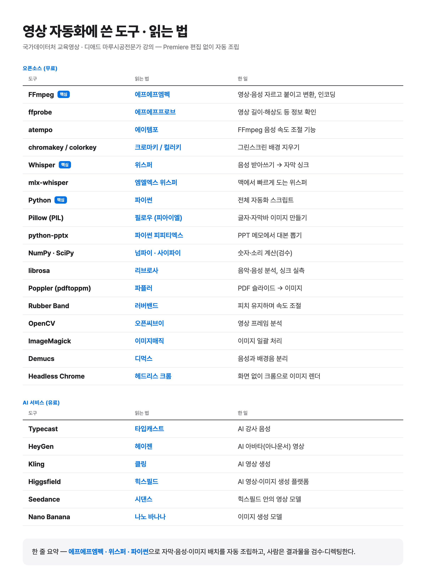

# 교육 영상 자동 조립 — 실제 작업 코드

AI 영상 크리에이터 강민석(minming)이 회사(플루닛)에서 맡은 교육 영상 두 건을 **Premiere 편집 없이** 만든 코드 모음입니다.
코드는 Claude Code · Codex 에이전트가 짜고, 사람은 디렉팅 · 검수만 했습니다.

| 프로젝트 | 분량 | 이 저장소에 있는 것 |
|---|---|---|
| **디애드 마루시공전문가 강의** (2026.10~11) | 04~20강 17편 | 강의별 조립 · 렌더 · 검사 스크립트 전부 (`maru-lecture/`) |
| **국가데이터처 교육영상** (2026.9~10) | 8편 납품 | 여기서 처음 만든 검사기를 공통으로 다듬은 것 (`checkers/`) · 조립 코드는 납품 뒤 정리하며 지워서 없음 |



## 한 편이 만들어지는 순서 (마루시공)

```
PPT 메모(대본) ──▶ AI 강사 음성(Typecast)
                    │
                    ▼
       받아쓰기(mlx-whisper)로 단어마다 시각 재기   ← align.py · mlx_words.py · linetimes_make.py
                    │
                    ▼
     슬라이드 · 자막바 · 아나운서 영상 배치표 만들기   ← make_tl_*.py · notes_extract.py · place16.py
                    │
                    ▼
            FFmpeg 로 한 번에 렌더                 ← render_v*.py · ending.py · cut_greet.py
                    │
                    ▼
        검사대 통과 못 하면 사람에게 안 올림          ← check_*.py · sent_check*.py · gap_check21.py · still16.py · edge16.py
```

- **05~20강 16편 · 렌더 합계 4시간 4분(실측)**. 11~20강 10편은 밤 00:00~02:20 사이에 에이전트들이 끝냈습니다.
- 오더서 54장 · 판정서 76장 · 사람 지적 39건 · 검사기 8개가 이 과정에서 나왔습니다.

## 폴더 읽는 법

- `maru-lecture/NN강/work/` — 그 강의를 만든 스크립트. **`render_v3` → `v3b` → `v4` …처럼 판이 늘어난 기록을 지우지 않고 그대로 두었습니다.** 마지막 번호가 납품판에 쓴 것입니다.
- `maru-lecture/NN강/아나운서B/` — 아나운서 영상을 음성 길이에 맞게 늘이고 줄인 것(warp).
- `maru-lecture/오더NN/` — 여러 강의에 한 번에 건 수정(예: `오더09_공용` = 공용 검사 · 배치 도구).
- `checkers/` — **같은 실수가 두 번 나오면 기계로 잡도록** 만든 검사기 14개(대부분 국가데이터처·마루시공에서, 13번은 다른 영상 작업에서). 사용법은 [`checkers/README.md`](checkers/README.md) — 그 안의 `모음/1_어디서나_쓰는것/` 경로는 이 `checkers/` 폴더로 읽으면 됩니다.
  - 예: 앞판과 새판을 비교해 「시키지 않은 곳이 바뀌었나」 · 자막이 말보다 늦게 뜨나 · 빈 자막바 · 지직 소리 · 받아쓰기와 대본 대조 · 멈춘 화면.

## 돌려 보려면

이 코드는 **실제 작업 폴더 경로를 그대로 쓰고 있어서** 받아서 바로 돌아가지는 않습니다(음성 · 슬라이드 · 영상 원본은 올리지 않았습니다).
「어떤 단계를 어떤 방식으로 자동화했는지」를 보는 기록으로 읽어 주세요.

필요한 것: Python 3 · FFmpeg · mlx-whisper(Apple Silicon) · Pillow · NumPy · OpenCV · python-pptx · Poppler.

## 잘 안 된 것도 남깁니다

- 공개 전 Codex 검수(2026-11-12)에서 검사기 버그 8개가 나와 같은 날 고쳤습니다. 가장 큰 3개: 자막이 통째로 사라지면 09가 못 잡음 · 07이 영상 읽기에 실패해도 OK로 표시 · 12가 다른 영상에 옛 중간 파일을 재사용. 고친 뒤 일부러 틀린 영상을 만들어 잡는지 확인했습니다.
- 판이 바뀔 때마다 스크립트를 복사해 이름만 바꾸다 보니, 같은 파일이 강의마다 여러 벌 있습니다(`still16.py` 30벌 등).
- 쉼을 넣거나 빼서 시계가 밀린 판은 앞판·새판 비교 검사기가 뒤 전체를 「바뀜」으로 잘못 잡았습니다(6강 221곳 오탐) → `checkers/12_…` 로 보완.
- 「프로그램이 끝까지 돌았다」 ≠ 「합격」. 걸린 곳은 결국 사람이 그 시각 화면을 열어 확인했습니다.
